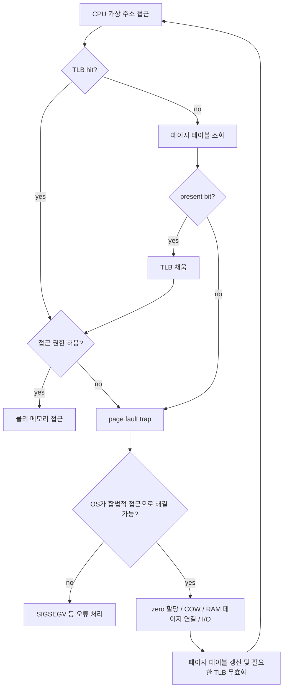

# 가상 메모리와 페이지 교체 (Virtual Memory & Page Replacement)

- Level: Intermediate
- Prerequisites: [Systems/Operating-Systems/Memory-Management.md](Memory-Management.md)
- Status: Draft
- Reviewed-by: -
- Depth: Deep-dive (자기완결)

---

## 개념 (Concept)

가상 메모리는 프로세스가 사용하는 가상 주소를 물리 메모리에 대응시키고, 접근 권한과 공유·격리를 관리하는 추상화다. 주소 공간은 희소하게 구성하거나 물리 메모리보다 크게 만들 수 있지만, 스왑을 사용하지 않는 시스템에도 가상 메모리는 존재한다. [OSTEP의 주소 공간 설명](https://pages.cs.wisc.edu/~remzi/OSTEP/vm-intro.pdf)은 이러한 주소 변환과 보호를 기본 목적으로 다룬다.

**요구 페이징(demand paging)** 은 접근 시점에 필요한 페이지의 준비를 미루는 방식이다. 준비할 내용은 파일·스왑에서 읽을 데이터일 수도, 처음 사용하므로 0으로 채울 메모리일 수도 있다. **페이지 폴트(page fault)** 는 현재 주소 변환·권한 상태로 접근을 완료할 수 없을 때 발생하는 CPU 예외이며, 디스크 읽기를 뜻하지 않는다. 이미 RAM에 있는 페이지라도 copy-on-write(COW) 처리나 권한 위반으로 폴트가 날 수 있다.

## 직관 (Intuition)

책상(RAM)은 좁고 책장(저장장치)은 넓다. 지금 보는 책만 책상에 두고, 공간이 부족하면 덜 쓰는 책을 치운다. 이것이 페이지 교체의 직관이다. 다만 빈 노트를 새로 받거나 공유 노트의 사본을 만드는 경우도 있어, 책상에서 못 찾을 때마다 책장에 가는 것은 아니다.



그림은 하드웨어가 페이지 테이블을 조회하는 시스템의 개념 흐름이며, 자원 부족·I/O 실패 처리는 생략했다. TLB miss 자체는 page fault가 아니며, TLB hit도 권한 검사를 면제하지 않는다.

## 이론 (Theory)

물리 메모리가 꽉 찼는데 새 페이지가 필요하면, 기존 페이지 하나를 내보내야 한다. 어떤 페이지를 고르냐가 **페이지 교체 알고리즘**이다.

| 알고리즘 | 기준 | 특징 |
|---|---|---|
| FIFO | 가장 먼저 들어온 페이지 | 단순, 벨라디의 모순 발생 |
| OPT(최적) | 앞으로 가장 늦게 쓸 페이지 | 이론적 최소 폴트, 미래를 알아야 해 비현실적 |
| LRU | 가장 오래 안 쓴 페이지 | OPT 근사, 구현 비용 있음 |
| Clock(2차 기회) | 참조 비트 순회 | LRU의 실용적 근사 |

활발하게 재사용하는 페이지 집합(**워킹 셋, working set**)이 가용 RAM에 들어가지 않아 페이지 반입·퇴출이 반복되면, 유용한 실행보다 페이징에 많은 시간을 쓰는 **스래싱(thrashing)** 에 빠질 수 있다. 처음 할당한 페이지를 한 번씩 만져 생기는 폴트가 많다는 사실만으로 스래싱이라 판정하지 않는다. 단순화된 유효 접근 시간은 폴트율 $p$로 다음과 같이 추정한다.

$$\text{EAT} = (1-p)\times t_{\text{mem}} + p \times t_{\text{fault}}$$

$t_{\text{fault}}$는 폴트 발생부터 처리·명령 재실행까지 해당 접근에 걸리는 전체 시간으로 정의한다. 폴트가 없는 경로의 비용이 $t_{\text{mem}}$이다. 저장장치 I/O가 필요한 폴트라면 두 비용의 차이가 클 수 있다. 실제 계산에서는 minor·major 폴트의 비율과 비용을 구분해야 하며 모든 폴트에 같은 디스크 지연을 대입하면 안 된다.

### 페이지 폴트 처리 흐름

OS는 가상 주소 영역과 요청한 읽기·쓰기·실행 권한, COW 같은 관리 상태를 확인한다. 정상적으로 해결할 수 있는 폴트라면 필요한 작업을 수행하고 페이지 테이블과 TLB 상태를 일관되게 만든 뒤 명령을 재실행한다. 새 프레임이 필요해도 항상 기존 페이지를 디스크에 쓰는 것은 아니다. 빈 프레임을 쓰거나, 원본 파일에서 다시 읽을 수 있는 clean 페이지를 버릴 수도 있다.

| 상황 | 처리 예 | 저장장치 I/O와의 관계 |
|---|---|---|
| demand-zero | 새 익명 메모리에 0으로 초기화된 내용을 제공 | 기존 내용을 디스크에서 읽을 필요 없음 |
| COW 쓰기 | 논리적으로 쓰기 가능한 공유 페이지를 전용 사본으로 분리 | 원본이 RAM에 있으면 메모리 내 복사로 처리 가능 |
| 파일 페이지가 page cache에 있음 | 이미 RAM에 있는 페이지를 이 프로세스에 연결 | 디스크 읽기 없이 처리 가능 |
| 필요한 파일·스왑 내용이 RAM에 없음 | 저장장치에서 내용을 가져옴 | I/O가 필요 |
| 매핑이 없거나 접근 권한 위반 | 정상 접근으로 복구할 수 없으면 프로세스에 신호 전달 | 페이지를 읽어 오는 것으로 해결되지 않음 |

Linux [`getrusage(2)`](https://man7.org/linux/man-pages/man2/getrusage.2.html)는 I/O 없이 처리한 폴트를 `ru_minflt`(minor), I/O가 필요했던 폴트를 `ru_majflt`(major)로 구분한다. 위의 demand-zero·COW는 I/O 없이 처리할 수 있는 대표 경로이지, 이름만으로 모든 상황의 비용을 확정하는 분류는 아니다.

특히 COW를 위해 일시적으로 읽기 전용으로 만든 페이지와, 애플리케이션에 정말 쓰기가 금지된 페이지를 구별해야 한다. 전자는 OS가 쓰기를 허용하도록 해결할 수 있지만, 후자에 쓰면 매핑이 존재해도 `SIGSEGV`가 발생할 수 있다([`mprotect(2)`](https://man7.org/linux/man-pages/man2/mprotect.2.html)). 파일 매핑의 파일 끝을 넘는 페이지 접근은 `SIGBUS`가 될 수도 있다([`mmap(2)`](https://man7.org/linux/man-pages/man2/mmap.2.html)).

## 구현 (Implementation)

LRU 페이지 교체만 시뮬레이션한다. 입력 `pages`는 정수 페이지 ID의 유한한 참조열, `capacity`는 양의 정수 프레임 수다. 0 이하 용량은 `ValueError`, 정수가 아닌 용량은 `TypeError`로 거절한다. 빈 참조열의 폴트 수는 0이다. 여기서 `faults`는 캐시에 없는 페이지를 참조한 횟수이며, Linux의 minor·major 구분이나 COW·권한 검사를 구현하지 않는다.

```python
def lru_faults(pages, capacity):
    if type(capacity) is not int:
        raise TypeError("capacity must be an integer")
    if capacity <= 0:
        raise ValueError("capacity must be positive")
    cache, faults = [], 0
    for p in pages:
        if p in cache:
            cache.remove(p)        # 최근 사용으로 갱신
        else:
            faults += 1
            if len(cache) == capacity:
                cache.pop(0)       # 가장 오래 안 쓴 것 제거
        cache.append(p)
    return faults


refs = [1, 2, 3, 1, 4, 2, 5]
assert lru_faults(refs, capacity=3) == 6
assert lru_faults([], capacity=3) == 0
assert lru_faults([1, 1, 2, 1], capacity=1) == 3
assert lru_faults([1, 2, 1, 2], capacity=2) == 2
for invalid, expected_error in ((0, ValueError), (-1, ValueError), (1.5, TypeError)):
    try:
        lru_faults(refs, invalid)
    except expected_error:
        pass
    else:
        raise AssertionError("invalid capacity must be rejected")
print(lru_faults(refs, capacity=3))   # 6
```

Python 3에서 외부 패키지 없이 실행하면 assert를 통과하고 `6` 한 줄을 출력한다.

워크드 trace(capacity 3, LRU):

| 참조 | cache 상태 | fault? |
|---|---|---|
| 1 | [1] | yes |
| 2 | [1, 2] | yes |
| 3 | [1, 2, 3] | yes |
| 1 | [2, 3, 1] | no |
| 4 | [3, 1, 4] | yes, 2 제거 |
| 2 | [1, 4, 2] | yes, 3 제거 |
| 5 | [4, 2, 5] | yes, 1 제거 |

## 복잡도 (Complexity)

| 항목 | 비용 |
|---|---|
| 페이지 적중(hit) | 주소 변환·권한 검사 및 캐시/메모리 접근 비용 |
| minor 페이지 폴트 | 커널 처리·매핑 갱신 및 필요시 할당·복사; 고정된 디스크 지연이 아님 |
| major 페이지 폴트 | 커널 처리와 I/O 대기; 저장장치와 시스템 부하에 따라 달라짐 |
| LRU 정확 구현 | 접근마다 갱신, 하드웨어 지원 또는 근사 필요 |
| TLB 적중 | 캐시된 주소 변환과 권한 사용; 페이지 테이블 탐색을 생략 |

TLB(Translation Lookaside Buffer)는 최근 주소 변환을 캐시해, 페이지 테이블 조회 비용을 줄인다.

위 Python 구현은 참조 수 $n$, 용량 $c$에 대해 리스트 검색·삭제 때문에 $O(nc)$ 시간, $O(c)$ 추가 공간을 쓴다. 이는 교육용 LRU 시뮬레이터의 비용이며 실제 OS 페이지 교체 구현의 비용을 대표하지 않는다.

가상 계산 예제: 정상 접근 100ns, 모든 폴트 경로의 전체 비용을 10ms, 폴트율을 0.1%로 가정하면

$$\text{EAT}=0.999\times100\text{ns}+0.001\times10\text{ms}\approx10.1\mu s$$

이 가정에서 평균 접근 시간은 10.0999마이크로초로 정상 경로의 약 101배다. 10ms는 실측값이나 모든 page fault의 일반적인 비용이 아니다. 이 예제는 드물지만 비싼 I/O 경로가 평균에 미치는 영향을 보여 준다.

## 응용 (Applications)

- 물리 메모리보다 큰 프로그램 실행
- 프로세스 격리와 메모리 보호
- 메모리 맵 파일(mmap), 공유 라이브러리
- copy-on-write(fork 시 페이지 공유 후 쓰기 시점 복사)

## 흔한 오해 (Common Misunderstandings)

- 가상 메모리는 "RAM을 늘리는 마법"이 아니다. 디스크는 RAM보다 압도적으로 느려, 스왑에 의존하면 성능이 급락한다.
- 페이지가 많을수록 항상 폴트가 주는 건 아니다. FIFO에서는 프레임을 늘려도 폴트가 늘 수 있다(**벨라디의 모순, Belady's anomaly**). LRU·OPT는 이 모순이 없다.
- LRU가 항상 최적은 아니다. OPT가 이론적 하한이고 LRU는 근사다.
- 페이지 폴트가 항상 프로그램 오류이거나 디스크 읽기는 아니다. demand-zero·COW 같은 정상 처리 경로가 있고, 매핑이 있어도 권한 위반으로 `SIGSEGV`가 발생할 수 있다.

## TMI

- 벨라디의 모순은 1969년 발견됐다. "메모리를 늘렸는데 더 느려진다"는 반직관적 현상이라 시험 단골 주제다.
- Linux `fork()`의 COW는 데이터 페이지 복사를 쓰기 시점까지 미루지만 즉시·무비용 복제를 보장하지 않는다. 페이지 테이블 복제와 자식 태스크 생성 비용은 남는다([`fork(2)`](https://man7.org/linux/man-pages/man2/fork.2.html)).
- 스래싱에 빠진 시스템은 디스크 표시등만 계속 깜빡이고 화면은 멈춘 것처럼 보인다. 해결책은 보통 실행 프로세스 수를 줄이거나 RAM을 늘리는 것이다.

## 연습 / 확인 문제 (Exercises)

- 같은 참조열에 FIFO와 LRU를 적용해 페이지 폴트 수를 비교하라.
- FIFO에서 프레임을 3개→4개로 늘렸을 때 폴트가 늘어나는 벨라디의 모순 예제를 찾아라.
- 폴트율 `p`와 디스크/메모리 접근 시간으로 유효 접근 시간(EAT)을 계산하는 함수를 작성하라.
- 새 익명 페이지의 첫 접근, RAM에 있는 COW 페이지 쓰기, 실제 읽기 전용 매핑에 쓰기를 각각 정상 처리 가능 여부와 I/O 필요 여부로 설명하라.
- TLB miss가 발생해도 page fault 없이 접근할 수 있는 경우를 제시하라. 힌트: 유효하고 접근 권한이 맞는 페이지 테이블 항목이 있다.

## 이어서 읽기 (Reading Path)

- 이전: [메모리 관리](Memory-Management.md)
- 다음: [파일 시스템](File-Systems.md)
- 관련: [데이터 표현](../Computer-Architecture/Data-Representation.md)

## 참조 (References)

- [OSTEP: The Abstraction: Address Spaces](https://pages.cs.wisc.edu/~remzi/OSTEP/vm-intro.pdf) — §13.4 Goals와 §13.5 Summary의 주소 변환·격리·보호 목적.
- [OSTEP: Complete Virtual Memory Systems](https://pages.cs.wisc.edu/~remzi/OSTEP/vm-complete.pdf) — §23.1의 Other Neat Tricks: demand zeroing과 copy-on-write의 지연 처리 원리. 현재 Linux의 세부 구현 절차를 그대로 지정하는 자료는 아니다.
- [OSTEP: Beyond Physical Memory: Policies](https://pages.cs.wisc.edu/~remzi/OSTEP/vm-beyondphys-policy.pdf) — OPT·FIFO·LRU·Clock, Belady's Anomaly, §22.11 Thrashing 및 평균 접근 비용 계산의 가정.
- [Linux man-pages: getrusage(2)](https://man7.org/linux/man-pages/man2/getrusage.2.html) — DESCRIPTION의 `ru_minflt`·`ru_majflt`: I/O 필요 여부에 따른 집계 구분.
- [Linux man-pages: mmap(2)](https://man7.org/linux/man-pages/man2/mmap.2.html) — `MAP_ANONYMOUS`의 0 초기화, `MAP_PRIVATE`의 COW, `SIGSEGV`·`SIGBUS` 조건.
- [Linux man-pages: mprotect(2)](https://man7.org/linux/man-pages/man2/mprotect.2.html) — DESCRIPTION의 보호 권한 위반과 `SIGSEGV`.
- [Linux man-pages: fork(2)](https://man7.org/linux/man-pages/man2/fork.2.html) — NOTES의 Linux COW 및 페이지 테이블·태스크 생성 비용.
- [Systems/Operating-Systems/Memory-Management.md](Memory-Management.md)
- [Reference/Books.md](../../Reference/Books.md)
- [Reference/Courses.md](../../Reference/Courses.md)

## 재작성 메모 (Rewrite Notes)

- 재사용할 재료: 폴트 원인별 처리 표, 권한 검사를 포함한 주소 변환 그림, 입력 계약·assert가 있는 LRU 예제와 참조열 trace, 가정을 명시한 EAT 계산.
- 보충할 내용: Linux에서 익명 메모리·COW·파일 매핑의 minor/major 카운터 비교 실험, page cache 상태와 메모리 압력 통제, 사용 CPU의 예외·TLB 갱신 규칙. 시뮬레이터의 miss 수를 실제 OS 폴트 수로 해석하지 않도록 실험을 분리할 것.
- 확인 상태: 2026-09-16에 위 OSTEP 저자 공개본과 Linux man-pages의 대응 절에 접근. LRU 예제의 정상·빈 입력·반복 참조·잘못된 용량 assert와 출력 `6`을 로컬 Python 3에서 확인; Linux 커널 폴트 실험은 수행하지 않음. 사람 검토는 수행하지 않음.
